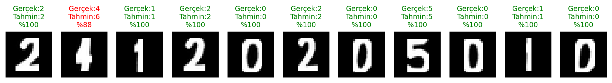

# MNIST ile MLP Tabanlı El Yazısı Rakam Tanıma

**Ad Soyad:** Rüya Taştan
**Öğrenci No:** 24120205010

## Proje Hakkında
MNIST veri seti ile CNN kullanmadan, sıfırdan eğitilmiş bir MLP modeli geliştirildi. Model daha sonra kendi el yazımla yazdığım okul numarası üzerinde test edildi. Kod PyTorch ile yazıldı ve Google Colab'da çalıştırıldı.

## Dosyalar
- `mnist_mlp.ipynb`: Tüm kod (veri hazırlama, eğitim, test, kendi rakamlarım)
- `loss_accuracy_grafik.png`: Eğitim sürecindeki loss ve accuracy grafikleri
- `IMG_3374.png`: Okul numaramın orijinal fotoğrafı
- `my_digits/`: MNIST formatına çevrilmiş rakamlar ve tahmin sonuçları

## Veri Ayrımı
| Küme | Örnek sayısı |
|---|---|
| Train | 50.000 |
| Validation | 10.000 |
| Test | 10.000 |

MNIST'in 60.000'lik eğitim setinden 10.000'i validation için ayrıldı. 10.000'lik test seti model geliştirilirken kullanılmadı, sadece eğitim sonunda bir kez değerlendirildi.

## Hiperparametreler
| Parametre | Değer |
|---|---|
| Mimari | 784 → 256 → 128 → 10 |
| Aktivasyon | ReLU |
| Loss fonksiyonu | CrossEntropyLoss |
| Optimizer | Adam |
| Learning rate | 0.001 |
| Batch size | 64 |
| Epoch | 10 |
| Normalizasyon | mean = 0.1307, std = 0.3081 |

## Deney 1 Sonuçları
| Metrik | Değer |
|---|---|
| Training loss | 0.0204 |
| Validation loss | 0.1039 |
| Training accuracy | 0.9934 |
| Validation accuracy | 0.9774 |
| Test loss | 0.0974 |
| Test accuracy | 0.9787 |
| Eğitim süresi | 156.9 saniye |

## Kendi El Yazım ile Test
Okul numaram `24120205010` kâğıda yazıldı, fotoğrafı çekildi ve her rakam ayrı ayrı MNIST formatına dönüştürüldü (gri tonlama, gölge düzeltme, çizgi kalınlaştırma, 28×28, siyah zemin üzerine beyaz rakam, MNIST ile aynı normalizasyon).

| | |
|---|---|
| Gerçek numara | 24120205010 |
| Model tahmini | 26120205010 |
| Doğru | 10/11 (%90,9) |

## Genel Değerlendirme
- **Overfitting:** Train accuracy 0.9263'ten 0.9934'e yükselirken validation accuracy yaklaşık 0.977 civarında düzleşti. Validation loss 6. epoch'ta en düşük değerine (0.0887) ulaşıp sonra yükseldi, train loss ise düşmeye devam etti. Bu, modelin eğitim verisini ezberlemeye başladığını gösterir.
- **Test sonucu:** Test accuracy (0.9787) validation accuracy (0.9774) ile çok yakın, yani model görmediği MNIST verisinde de tutarlı çalışıyor.
- **Gerçek el yazısı:** Model kendi el yazımdaki 11 rakamın 10'unu doğru tahmin etti. Hata yapılan rakam 4 oldu ve model bunu %88 güvenle 6 olarak tahmin etti. Model yanlış tahminlerinde de yüksek güven gösterebiliyor, bu yüzden güven yüzdesi doğruluğun garantisi değil.
- **Distribution shift:** MNIST ile benim yazım arasında kalem kalınlığı, yazı stili, fotoğraf koşulları ve ön işleme farkları var. Bu fark nedeniyle model gerçek dünya verisinde MNIST test başarısından daha düşük ve daha az güvenilir sonuç verebilir. Sadece 11 örnekle test yapıldığı için %90,9 değeri istatistiksel olarak güvenilir bir ölçü değildir, tek bir rakam sonucu yaklaşık 9 puan değiştirir.
- **Olası neden (varsayım):** 4'ün 6 olarak tahmin edilmesinde çizgi kalınlaştırma sırasında rakamın üst kısmının dolgunlaşmasının etkili olmuş olabileceğini düşünüyorum, ancak bunu ayrıca test etmedim.
